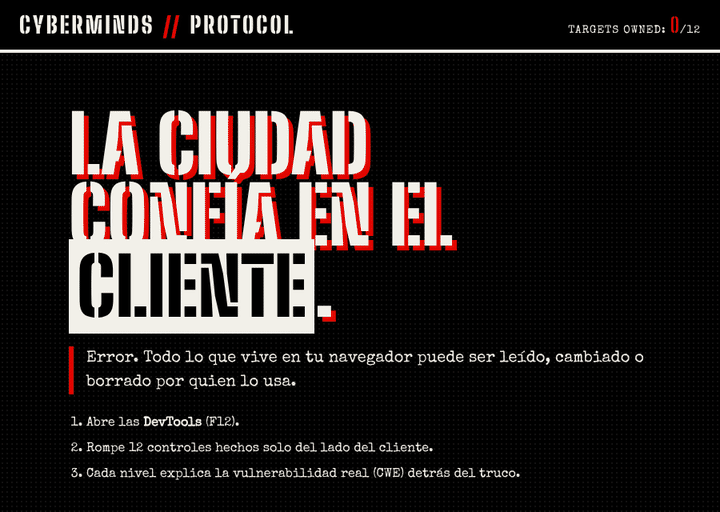

# CyberMinds Protocol

A 12-level, browser-only CTF that teaches client-side web security. No installs, no backend: just your browser's **DevTools (F12)**.

**▶ Play it live: https://crstxkng.github.io/cyberminds-protocol/**

## The lesson

Every check in this game runs in the browser, and every one of them can be broken. That's the point: **never trust the client.** Each level shows one way that goes wrong and names the real weakness behind it.

## Levels

| #  | Level              | What you break                        | CWE | OWASP Top 10 (2021) |
|----|--------------------|---------------------------------------|-----|---------------------|
| 01 | CSS Hiding         | Element hidden with `display:none`    | [CWE-656](https://cwe.mitre.org/data/definitions/656.html) Security through obscurity | A04 Insecure Design |
| 02 | Disabled Attribute | Button locked with `disabled`         | [CWE-602](https://cwe.mitre.org/data/definitions/602.html) Client-side enforcement of server-side security | A04 Insecure Design |
| 03 | Password Masking   | Secret in a `type="password"` field   | [CWE-312](https://cwe.mitre.org/data/definitions/312.html) Cleartext storage of sensitive info | A02 Cryptographic Failures |
| 04 | Input Length       | `maxlength` limit                     | [CWE-20](https://cwe.mitre.org/data/definitions/20.html) Improper input validation | A03 Injection |
| 05 | Hidden Pricing     | Price in a hidden input               | [CWE-472](https://cwe.mitre.org/data/definitions/472.html) External control of assumed-immutable parameter | A04 Insecure Design |
| 06 | Cookie Auth        | Role stored in an unsigned cookie     | [CWE-565](https://cwe.mitre.org/data/definitions/565.html) Cookies without integrity checks | A07 Identification & Auth Failures |
| 07 | Local Storage      | Permission flag in `localStorage`     | [CWE-922](https://cwe.mitre.org/data/definitions/922.html) Insecure storage of sensitive info | A01 Broken Access Control |
| 08 | JS Variables       | Global access-state variable          | [CWE-603](https://cwe.mitre.org/data/definitions/603.html) Client-side authentication | A07 Identification & Auth Failures |
| 09 | Function Rewrite   | `authCheck()` overwritten at runtime  | [CWE-603](https://cwe.mitre.org/data/definitions/603.html) Client-side authentication | A07 Identification & Auth Failures |
| 10 | Comments Leak      | Secret in an HTML comment             | [CWE-615](https://cwe.mitre.org/data/definitions/615.html) Sensitive info in source comments | A05 Security Misconfiguration |
| 11 | Time Travel        | Client-side countdown                 | [CWE-602](https://cwe.mitre.org/data/definitions/602.html) Client-side enforcement of server-side security | A04 Insecure Design |
| 12 | Network Sniffer    | Secret header in a `fetch` request    | [CWE-798](https://cwe.mitre.org/data/definitions/798.html) Hard-coded credentials | A07 Identification & Auth Failures |

Every level in the game explains its concept and includes a hint.

## Run locally

Open `index.html` in a browser. That's it.

## Deploy (GitHub Pages)

Settings → Pages → *Deploy from a branch* → `main` / `(root)`.

## ⚠️ Warning

This code is **intentionally vulnerable**. Do not reuse it in production.

The game UI is in Spanish. License: [MIT](docs/LICENSE).
